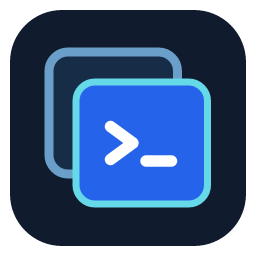

<p align="center">
  
</p>

<h1 align="center">VM Manager for VS Code</h1>

<p align="center">
  <a href="https://marketplace.visualstudio.com/items?itemName=sourceregistry.vm-manager"></a>
  <a href="https://marketplace.visualstudio.com/items?itemName=sourceregistry.vm-manager"></a>
  <a href="https://github.com/SourceRegistry/vscode-virtual-machine-manager/actions/workflows/release.yml"></a>
  <a href="LICENSE"></a>
</p>

Manage your virtual machines without leaving VS Code. See every machine at a glance, start and stop
them, change their settings and work in their consoles in an editor tab, next to your code.

* **One place for all your hypervisors**: Hyper-V, QEMU, Proxmox VE and libvirt.
* **Consoles in the editor**: the machine's screen or its serial console in a tab, which you can
  drag to another window.
* **Looks like VS Code**: everything follows your theme and uses the views, menus and command
  palette you already know.

## Get started

1. **Install a provider** for your hypervisor. VM Manager itself does not talk to any hypervisor;
   providers do:

   | Provider | For |
   |---|---|
   | [VM Manager – Hyper-V](https://marketplace.visualstudio.com/items?itemName=sourceregistry.vm-manager-hyperv) | Hyper-V on this Windows machine |
   | [VM Manager – libvirt](https://marketplace.visualstudio.com/items?itemName=sourceregistry.vm-manager-libvirt) | libvirt (KVM/QEMU) domains on this computer or over SSH |
   | [VM Manager – Proxmox VE](https://marketplace.visualstudio.com/items?itemName=sourceregistry.vm-manager-proxmox) | Remote Proxmox VE clusters over HTTPS |
   | [VM Manager – QEMU](https://marketplace.visualstudio.com/items?itemName=sourceregistry.vm-manager-qemu) | QEMU machines on Windows, Linux and macOS |

   XCP-ng, VMware and Nutanix are planned. **VM: Install Hypervisor Providers** lists the providers you can install.
2. Open the **Virtual Machines** view in the activity bar and click **Add Cluster**.
3. Your machines appear in the view. Right-click one for everything you can do with it.

The walkthrough (**VM: Get Started with VM Manager**) shows the same steps.

## Find your way around

Machines are grouped as **cluster → node → virtual machine**:

```
Local (Hyper-V)            ← cluster: one hypervisor you added
└─ DESKTOP-ALEX            ← node: a host in it
   ├─ web-01  Running      ← virtual machines
   └─ db-01   Off
```

* **Virtual Machines view**: state icons, the running count as a badge, and quick actions next to
  each machine (start, connect, shut down). A graceful shutdown counts down in the view and the status bar
  (*Shutting down… 23 s left*) until the hypervisor gives up on the guest.
* **Favorites and groups**: a **Groups** view under the main one holds **Favorites** (**Add to Favorites**)
  and groups of your own: **New Group…** in its title bar, then drag machines in from Clusters (dragging
  between groups moves them) or use **Add to Group…** on a machine. A machine can be in several groups; the
  ✕ next to it removes it from that group, and a group's menu renames or deletes it (its machines stay).
  **VM: Group By…** (or `vmm.tree.groupBy`) groups the main view by cluster, group or state. VM Manager
  keeps favorites and groups itself; the hypervisor never sees them.
* **Overview** (**VM: Open Overview**): a dashboard of everything you manage.
  * A summary of machines by state (click a state to filter the table) and of the processors and
    memory allocated against what the nodes have, flagged when they are overcommitted.
  * A card per node with its CPU load and memory, plus facts such as the QEMU version or host OS.
  * One table of all machines across all clusters: filter by name, host or IP, sort by any column,
    with a CPU sparkline per machine. Right-click a row for the same menu as in the tree.
  * Select several machines to start, shut down or power them off together.
* **Search** (**VM: Search Virtual Machines…**): jump to a machine by name from the command palette.
* **Status bar**: the number of running machines; click it to open the Overview.
* **Show Log** opens a log for one machine: what you asked for from VS Code and how it ended, state changes
  (also ones made outside VS Code), guest commands, copies, snapshots and media, with the hypervisor's own log
  for the machine underneath (QEMU's output; libvirt's domain log on this computer). It covers the time since
  VS Code started.
* **Notifications** tell you when a machine starts or stops without you asking for it here: the guest shut
  itself down, another tool started it, it crashed. `vmm.notifications.stateChanges` turns them off or on for
  every change. They come from the refreshes, so from machines whose view or Overview is visible, or whose
  provider reports changes (QEMU does).

## Work with machines

* **Create** a machine from a node's context menu: name, processors, memory, disk, installation ISO
  and network, step by step. With QEMU and libvirt it can also start from a **cloud image** (Debian,
  Ubuntu) that sets itself up on first boot with your user, SSH key and the guest agent: no installer.
* **Settings** opens an editor for the machine's configuration. Some settings can only change while
  the machine is off.
* **Start, Shut Down, Reboot, Stop (Power Off)**. *Shut Down* asks the guest to shut down cleanly;
  *Stop* cuts the power. These run in the background: the machine shows a spinner and
  "Shutting down…" until it is done, and you can keep working. If a shutdown hangs, *Stop* is still
  available.
* **Show Details** opens a page for one machine: state, power actions, uptime, processors, memory,
  IP address, its disks, CD/DVD drives, network adapters, port forwards and PCI devices, and live
  charts (CPU, memory, disk throughput, operations and latency, and network where the provider
  reports it) over the last five minutes. Each chart has a **Show data** table.
* **Eject** and **Change ISO…** swap the installation media, also while the machine runs.
* **Snapshots** (**Take Snapshot…**, **Revert to Snapshot…**, **Delete Snapshot…**, or the *Snapshots* card on the details page) save the state of a machine's disks so you can return to it. QEMU saves disks only: taken while the machine runs, a snapshot is like a power cut. Reverting discards everything changed since and needs the machine powered off; VM Manager asks first and does it for you.
* **Clone…** makes an independent copy of a machine: its own disks and network address, the same hardware. Snapshots, port forwards and passed-through devices are not copied. The original must be shut down first, and a large disk takes a while.
* **Connect with Remote-SSH…** opens a running machine in a Remote - SSH window. It finds the way in from the
  machine's details: a port forward to port 22 (QEMU's NAT address is never offered), or an address the
  computer can reach. It checks that an SSH server answers first, and asks before adding an entry for the
  machine to your ssh config; nothing is written silently. **Forward SSH Port…** sets up the forward.
  **Add Machines to SSH Config…** and **Remove Machines from SSH Config…** let you choose which machines
  have an entry, so they work with plain `ssh <name>` and in Remote - SSH's host list.
* **Run Command in Guest…**, **Copy File to Guest…** and **Copy File from Guest…** work on a running machine through its
  guest agent (`qemu-guest-agent`, installed by the cloud-image setup), without SSH or a network route. The command runs in
  the guest's shell (`/bin/sh`, `cmd.exe` on Windows) as the agent's user, usually root; its output goes to the
  *VM Manager: Guest Commands* output channel. With the balloon driver in the guest, the memory chart shows what the guest
  itself uses rather than what the hypervisor holds on the host; the chart says which.
* **Delete** removes the machine, and its disks if you choose so.

### Automate with tasks, keybindings and launch configurations

A **`vm` task** starts, shuts down, reboots or powers off a machine and waits for it, for example before a debug
session. *Tasks: Run Task → VM Manager* also lists a Start and a Shut Down task for every machine.

```jsonc
// .vscode/tasks.json
{
  "version": "2.0.0",
  "tasks": [
    {
      "label": "Start test VM",
      "type": "vm",
      "vm": "web-01",          // its name, or "cluster/name" when two clusters have one
      "action": "start",       // start | shutdown | reboot | stop | reset
      "waitFor": "ssh",        // state (default) | address | ssh | none
      "timeout": 300           // seconds
    }
  ]
}
```

`start` does nothing on a running machine, `shutdown` nothing on one that is off, so the task can run before
every launch. In `launch.json`, `vmm.getVmAddress` and `vmm.getVmSshPort` give the address to connect to:

```jsonc
"inputs": [
  { "id": "vmHost", "type": "command", "command": "vmm.getVmAddress", "args": { "vm": "web-01", "ssh": true } },
  { "id": "vmPort", "type": "command", "command": "vmm.getVmSshPort", "args": { "vm": "web-01" } }
]
```

The power commands take a machine's name as argument, for keybindings:
`{ "key": "ctrl+alt+s", "command": "vmm.start", "args": "web-01" }`.
Other extensions get the same through the API: `vscode.extensions.getExtension('sourceregistry.vm-manager').exports.vms`
(`list`, `get`, `power`, `waitForState`, `address`, `onDidChangeState`).

### Bring in machines you already have

QEMU only, through the QEMU provider:

* **Attach to Running Virtual Machine…** finds `qemu-system-*` processes started outside VS Code and
  adds them, marked **external**. With a QMP socket you get full control; without one the machine is
  observe-only (stats and power off). An attached machine disappears when its process exits, and
  deleting it only detaches it. When an attached machine stops on its own, its tabs close and you get a notice; powering it off from here does not show one.
* **Import Virtual Machines from Folder…** reads disk images (qcow2, raw, vmdk, vdi, vhdx and more),
  another install's `vm.json`, libvirt domain XML and the disks of UTM bundles.

## What each provider supports

✓ works · – not available · *(note)* a limit worth knowing. Anything marked untested has not run on real hardware: see [How far each is verified](#how-far-each-is-verified).

| | Hyper-V | QEMU | Proxmox VE | libvirt |
|---|---|---|---|---|
| **Runs on** | Windows | Windows, Linux, macOS | any (server API) | Linux, macOS (needs `virsh`) |
| **Where the machines run** | this computer | this computer, or a Linux host over SSH | a Proxmox server | this computer, or a host over SSH (`qemu+ssh://`) |
| **Machines** | | | | |
| Create | ✓ | ✓ | ✓ | ✓ |
| Edit settings | ✓ | ✓ | ✓ | – |
| Delete (and its disks) | ✓ | ✓ | ✓ *(disks always go too)* | ✓ |
| Power: start, shut down, reboot, force stop | ✓ | ✓ | ✓ | ✓ |
| Reset (hardware reset) | – | – | ✓ | ✓ |
| Containers (LXC) | – | – | ✓ | – |
| Attach to running processes, import from a folder | – | ✓ *(attach also over SSH)* | – | – |
| Create from a cloud image (cloud-init) | – | ✓ | – | ✓ |
| **Consoles** | | | | |
| Graphical console in an editor tab | ✓ *(RDP, single sign-on)* | ✓ *(VNC)* | ✓ *(VNC)* | ✓ *(VNC)* |
| Serial console | ✓ | ✓ | ✓ | ✓ *(pty, socket or TCP; over SSH TCP only)* |
| Open the hypervisor's own viewer | ✓ | – | ✓ *(web UI)* | – |
| **Inspect** | | | | |
| Details page, live CPU / memory / disk charts | ✓ | ✓ | ✓ | ✓ |
| Guest IP addresses | ✓ *(integration services)* | ✓ *(guest agent)* | ✓ *(guest agent)* | ✓ *(DHCP leases, guest agent)* |
| Change or eject ISO | ✓ | ✓ | – | ✓ |
| Run commands and copy files in the guest | – | ✓ *(guest agent)* | – | ✓ *(guest agent)* |
| Memory used inside the guest | – | ✓ *(balloon driver)* | – | ✓ *(balloon driver)* |
| Hypervisor log in *Show Log* | – | ✓ *(QEMU's output)* | – | ✓ *(domain log, this computer)* |
| Shutdown countdown | – | ✓ | – | ✓ |
| **Protect and copy** | | | | |
| Snapshots | ✓ *(checkpoints)* | ✓ *(disks only, qcow2)* | ✓ *(disks only)* | ✓ *(with memory when running; not for UEFI with a raw nvram)* |
| Clone | ✓ *(export and import)* | ✓ | ✓ *(full copy)* | – |
| Templates | ✓ *(marked in the notes)* | ✓ | ✓ *(one way)* | – |
| **Network and devices** | | | | |
| Port forwards | – | ✓ | – | ✓ *(user-mode networking, this computer)* |
| Host device passthrough | experimental *(PCI, DDA)* | experimental *(USB; PCI on Linux)* | – | – |
| Connect with Remote-SSH | via address | via forward or address | via address | via address |
| **Sign-in** | Windows account | – | API token, password, OpenID Connect | SSH key or agent (for SSH hosts) |

Experimental means implemented and unit tested, but not yet verified on real hardware.

### How far each is verified

| | Verified against |
|---|---|
| Hyper-V | Unit tests only: there is no Windows host to run it on. Snapshots, clone and templates are new and have never run. |
| QEMU | Real QEMU on macOS (Apple Silicon, HVF) and Linux in CI, including a real Debian guest; SSH through a stand-in `ssh`, not yet a real remote machine. |
| Proxmox VE | Unit tests against a mocked API client; not yet a real Proxmox server. |
| libvirt | Real libvirt 12.9 with QEMU 11.1 on macOS (`qemu:///session`, HVF). Also a Debian 12 libvirt over `qemu+ssh://` (`qemu:///system`, no KVM). Not yet an x86 or KVM host. |

Remote Hyper-V and more libvirt features (clone, edit, storage pools) are on the [roadmap](docs/ROADMAP.md).

## Consoles

* **Graphical console**: the machine's screen in an editor tab, with keyboard and mouse. Hyper-V
  machines use the same connection as *Virtual Machine Connection*; QEMU machines use VNC.
* **Serial console**: a terminal on the machine's serial port, for Linux servers and boot logs.
* The tab's toolbar has **Send Ctrl+Alt+Del**, **Toggle Scaling**, **Type Clipboard Text**,
  **Reconnect**, the power actions and **Open in New Window**.
* **Type Clipboard Text** types the clipboard into the machine as key presses, for consoles without a
  shared clipboard (installers, login prompts). It types with a US keyboard layout.
* Consoles connect through VS Code itself, so they also work over Remote SSH, WSL and Codespaces.

## Your credentials

Passwords and tokens go to VS Code's Secret Storage (your operating system's keychain), never to
settings files. The Hyper-V console signs in with your Windows account, so it needs no password.
When a console does ask for a password, **VM: Forget Console Sign-in** removes the saved one.

## Settings

| Setting | Default | |
|---|---|---|
| `vmm.refreshInterval` | `5` | Seconds between state refreshes while the view or the Overview is visible. |
| `vmm.console.openInNewWindow` | `false` | Open consoles in a new window instead of an editor tab. |
| `vmm.console.scaleViewport` | `true` | Scale graphical consoles to fit the tab. |
| `vmm.confirmPowerOff` | `true` | Ask before a hard power off (*Stop*). |
| `vmm.ssh.user` | empty | Account to sign in as in a guest. Empty: your user name on this computer. Remembered per machine. |
| `vmm.ssh.addConfigEntry` | `true` | Offer to add an ssh config entry before connecting. Turn off to connect by address without touching the file. |
| `vmm.notifications.stateChanges` | `outside` | Notify when a machine starts, stops, pauses or resumes: `outside` only for changes VS Code did not ask for, `all`, or `off`. Each machine's log has them either way. |
| `vmm.tree.groupBy` | `cluster` | Group the Clusters view by `cluster`, `group` or `state`. Favorites and your groups also have their own view below it. |

Providers add their own settings, for example `vmm.qemu.path`.

## Feedback

Found a bug or missing a hypervisor?
[Open an issue](https://github.com/SourceRegistry/vscode-virtual-machine-manager/issues). To build the
extension yourself or write a provider, see [DEVELOPMENT.md](DEVELOPMENT.md).
